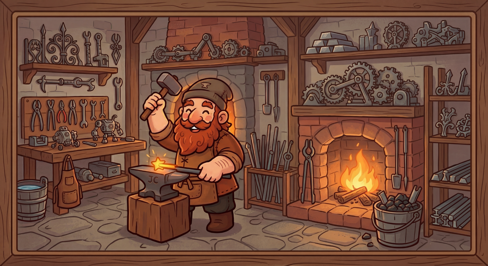

# Joycraft

<p align="center">
  
</p>

Joycraft helps your coding agent do larger work without losing track. You say what
you want. The agent writes it down, splits it into small steps, and builds each step
with tests. Then a second agent checks each step before it counts as done.

## Install: paste this into your coding agent

Open your coding agent in your project (Claude Code, Codex, Pi, Oh My Pi, GitHub
Copilot CLI or OpenCode) and paste:

```text
Install Joycraft in this project.
1. Run `npx joycraft@latest init . --plan --json`. Show me the files it will add in a short table. Do not change anything yet.
2. Ask me which coding agents I use in this project (default: you). Then run
   `npx joycraft@latest init . --harness <agents> --yes`.
   If it finds Joycraft 0.7, stop and show me its migration plan.
3. Use the joycraft-entry skill to set up Joycraft's context map. Read the project's
   docs, interview me about what the repo cannot tell you, then show me the
   AGENTS.md and CLAUDE.md changes on a page before you write them. If the project
   is new or empty, ask me what I want to build.
4. Show me the review loop that setup found: for each package, the tool that
   checks it and what that tool can show. If setup did not do this, run
   `node .joycraft/runtime/review-tools.mjs plan --root .`. Ask me before you
   install anything.
Do not commit, publish, or ask me for API keys.
```

**Upgrading from 0.7?** Nothing changes until you choose. Paste the
[upgrade prompt](docs/prompts.md#upgrade-from-07): your agent shows you the migration
plan and waits for your yes. To stay on 0.7, paste the
[stay on 0.7 prompt](docs/prompts.md#stay-on-07). More:
[Migrating from 0.7](docs/migrating-from-0.7.md).

## How to use it

After the install, talk to your agent as usual. Joycraft takes over when the work is
bigger than one quick change:

1. **You say what you want.** The agent asks a few questions. Then it writes a short
   brief that ends with "Done when": the result you will accept. You approve it.
2. **The agent splits the brief into specs.** A spec is one small step that it can
   build and test alone.
3. **The agent builds each spec with tests.**
4. **A second agent checks each spec.** It did not write the code. It reads the spec,
   runs the checks, and says PASS or FAIL. Only a PASS completes the spec. For a
   screen or page, it looks at the real result with the package's review tool
   (see [The review loop](#the-review-loop)).
5. **The agent wraps up.** It records what it learned for the next session.

You do not need to call the Joycraft skills by name. Describe the work and the agent
picks the right step.

On a new, empty project, the agent first asks what you want to build. It writes your
answers to `docs/context/project.md`. It does not choose a stack or write app code at
this step.

## The context map: your project's memory

`AGENTS.md` holds a short context map. Each line links one project document and
says when to read it. The documents live in `docs/context/`: what the project is,
who it is for, the decisions you made and why. Before each piece of work, the agent
uses the map to find the documents and the code that apply.

**After you install, the agent builds the map with you.** It reads your docs, gives
each one a role, checks what they claim against the code, and asks you what the repo
cannot tell it. Then it shows you the AGENTS.md and CLAUDE.md changes on a page and
writes them only on your yes. In a large project it maps the main docs first and
the rest of the project as work reaches it. If Joycraft is not wired into AGENTS.md
yet, `init`, `update` and `doctor` say so, and the agent sets it up before any other
Joycraft work.

The map grows with the project:

- **New facts go to one home.** When you decide something, the agent records it
  where it belongs and gives a new document a row in the map. It updates an
  existing document; it does not make a copy.
- **The map says what is true now.** A changed fact is rewritten in place. The
  reason goes to the decision log and old versions stay in Git and the archive, so
  a fresh session reads the current state instead of replaying history.
- **Finished work becomes history.** A completed feature moves to `docs/archive/`.
  The agent can check it later to catch a regression.
- **Mistakes become lessons.** When the checking agent fails a spec, the cause can
  become a short note for the next agent.
- **Ideas for later stay visible.** A choice you put off is marked "backlogged". It
  stays out of the current work, but it is not lost.

You can feed it too. Say "add this to the project context", "remove that rule" or
"what does the map say about billing", or give your agent meeting notes, a photo of
a whiteboard or a screenshot. It puts each fact in its home, keeps the map right, and
shows you the change first. This gives the
agent both views: the whole project and the detail of the current step.

### What in `docs/` is current

- **`docs/context/` is current.** It holds what the project is and the decisions you
  made. The agent keeps it up to date.
- **`docs/features/` is working material.** Briefs and specs record the plan for one
  piece of work. They can be out of date while the work runs. The spec queue
  (`.joycraft-spec-queue.json`) is the status of record, not the text.
- **`docs/archive/` is history.** Finished features move there.

**Your wiki.** Joycraft works with the wiki you already keep. Tell your agent where
it is: the agent links it from the context map and can update it each time a
feature is archived. In doc audits, `docs/features/` and `docs/archive/` are
working material and history, not current knowledge. A built-in wiki is under
consideration ([decision D6](docs/context/decision-log.md)).

```text
We keep a wiki in <where>. Link it from the context map, and keep it up to date
each time a feature is archived.
Do not commit, publish, or ask me for API keys.
```

### Settings

Joycraft works with no settings. To change one, say what you want:

```text
Change these Joycraft settings, and show me the change before you write it:
- Keep Joycraft's briefs and specs in working/features, and finished features in working/archive.
- Whenever a feature is archived, run our wiki sync script.
- The page docs/context/auction-rules.md describes src/auction. Flag it when that code changes.
Do not commit, publish, or ask me for API keys.
```

The agent writes the change to `joycraft.yaml` at the project root, shows it to you
first, and checks it. Ask "What are my Joycraft settings?" to see what is in effect.
The file is yours: Joycraft changes it only when you ask. If a command run after an
archive fails, the archive still counts as done.

### Keeping the workspace clean

At the end of a session the agent checks the workspace for you. You do not run
anything:

- **Status.** It runs the gate check (below). The check finds specs marked done with
  no accepted review and specs whose text disagrees with the queue. It also finds
  features that are finished but not archived.
- **Questions.** It asks you each follow-up question that the reviews left. See
  [Running a queue while you are away](#running-a-queue-while-you-are-away).
- **Worktrees.** It removes its worker worktrees once their spec is done and merged.
  It keeps anything unfinished, unmerged or not made by Joycraft, and says why.
- **One coordinator.** One session coordinates each queue, so a second session's
  instructions do not reach the first session's workers.
- **Stale knowledge.** It reports finished features not archived, context pages that
  link to working material, broken, missing or unmapped pages, an AGENTS.md over its
  word budget, and pages whose code changed.
- **Doc audit.** The audit, based on [doc-cleanup](https://github.com/aka-luan/doc-cleanup),
  runs at every session end without being asked. It puts its findings on the
  session-end page and makes only the mechanical fixes. It changes no rule and no
  page. For the full pass, see [Keeping AGENTS.md current](#keeping-agentsmd-current).
- **Wiring.** It checks that AGENTS.md has Joycraft's block and a real context map,
  and that CLAUDE.md imports it.

Tests name the acceptance criterion they check, `[AC:<criterion-id>]`, so the
reviewing agent can see which criteria have a test. A criterion with no test is a
finding for the reviewer, not an automatic FAIL.

If your docs are step-by-step procedures, the agent can offer
[Doc Detective](https://docs.doc-detective.com) to run them as tests. It is opt-in:
the agent says what it does not cover and installs nothing without your yes.

### Keeping AGENTS.md current

`AGENTS.md` is loaded in every session, so it must stay short and true. The file and
the pages behind its map go out of date together. When the file is long or old, ask
for a cleanup:

```text
Clean up my AGENTS.md and context pages.
Do not commit, publish, or ask me for API keys.
```

The cleanup is one pass, and it is a dialogue with you:

- **The file and its pages together.** The agent reads `AGENTS.md` and every page
  behind its map. It checks each statement two ways: is it true now, against the
  code and Git, and is it in the right place. Text that leaves `AGENTS.md` moves to
  the page that owns its topic. For a large project, the agent tells you the size
  and the cost first.
- **At most eight questions, on one page.** Each question is about one policy and
  not about one line. Two examples: have the rules for what the agent does without
  asking changed, and which of two rules that disagree is in force. Two of the
  questions are always about what the agent must ask before, and about holds. Every
  other choice is a recommendation, and you can veto it.
- **A permission ledger.** Before the commit, the agent lists each line that
  permits, forbids, stops or holds and that the pass changed. The old text is
  beside the new text, with the answer that decided it. The agent puts back a
  change that no answer decides. It does not remove a rule because the code breaks it.
- **Nothing temporal.** A date, a status or a finished plan moves out of `AGENTS.md`
  and the guides to the record that owns it: the decision log, a log page or the
  backlog. The agent asks you about holds. It does not drop a hold on its own
  recommendation. A hold that you keep stays as one rule, in `AGENTS.md` or on
  the page that owns its item.
- **Each finding gets a final status.** The status is fixed, left for you, or not
  done, with the reason. The agent fixes a false statement in each place that
  states it. Then an agent that wrote no edit checks the changed pages against the code.
- **One commit, on your yes.**

One pass does not find everything. Ask the agent to check the pages again. You can
also name one line that is wrong, and the agent fixes that line and each copy of
its claim.

Between cleanups, three things keep the file right:

- **Session end only reports.** It lists what it found and makes two mechanical
  fixes. When a release changed Joycraft's block, it replaces the block. When Git
  shows one file that a dead path was renamed to, it corrects the path.
- **Joycraft's block.** Joycraft's own lines in `AGENTS.md` are between two markers,
  `<!-- joycraft:managed -->`. After an update, the agent replaces only that block.
  Your text stays as it is.
- **A check for CI.** Run `node .joycraft/runtime/entry-check.mjs --ci`. It reads
  `AGENTS.md` and `CLAUDE.md`. It prints one line for each dead path, broken link,
  `@` import and package script that does not exist. It also prints a line for
  `AGENTS.md` files over the Codex limit of 32,768 bytes. Then it exits with code 2.
  On a clean project it prints nothing. A date in the file and a block that differs
  are notes for the agent. They do not fail CI.

## The review loop

The reviewing agent needs a tool that shows the real result: a browser for a web
app, a simulator for a mobile app, an HTTP check for an API. Joycraft decides what
counts as evidence; your project keeps its own tools.

- **Setup finds your tools.** For each package it looks for the tool you already
  use (Playwright, Cypress, WebdriverIO, Maestro, Newman, an e2e script, a CI job
  and others) and records one row per package in AGENTS.md, with what that tool can
  show. Tools that belong to this machine, such as your agent's built-in browser, go
  to `.joycraft/local/`. Packages that are not declared workspaces are found too, or
  name them with `--packages`.
- **A gap gets one recommendation.** If a package has no tool, the agent recommends
  one with its trade-offs and offers to look at others. It installs only on your yes,
  and never with `sudo`, a licence or a sign-in. A project with no app records that
  once and is not asked again.
- **Limits you agreed to are not failures.** A claim the recorded tool cannot show,
  or a package you skipped, is reported as a limit. `UNVERIFIED` means a check that
  should have run and did not.
- **Skipping review for one feature.** Say "skip review" in the feature interview.
  The feature's `waiver.json` records your words, and no reviewer runs for it. A
  waiver never hides a FAIL, and a new install keeps every check on.
- **A broken tool holds one spec.** If the browser or server breaks, the agent
  tries one repair (restart, free the port, relaunch). Then it holds that spec as
  `UNVERIFIED`, tells you, and keeps the rest of the queue going.

After an update, the agent checks the review loop again and asks only about what
changed.

### Running a queue while you are away

You can start a queue and leave. The agent asks its questions before the queue
starts. Work stops only for an answer that must come from you or for a broken
project. A broken tool that the agent cannot repair holds its spec, not the queue.
Other open points wait for you as a list of follow-up questions at session end.
You do not run a command at any step.

**Before the queue starts.** The agent checks each spec for gaps that a program can
find:

- An acceptance criterion has no check.
- A spec names an input file that does not exist and is not planned work.
- A spec depends on a spec that is not in the queue, or two specs depend on each
  other.
- A question in the brief is still open, and a queued spec needs its answer.

The agent adds each gap to the brief as a question and asks you while you are still
there.

**While you are away.** A question holds a spec only for a mandatory answer: a
case where two readings of the brief give opposite results for a stated criterion,
or where a wrong guess cannot be undone. The specs that depend on it wait too. All
other specs go on. Three other cases hold one spec and the specs that depend on
it: a broken tool, a refused fourth review, or a second FAIL on the same criterion.
The whole queue stops only for a broken project: it does not build or install, or
the repository is broken. It also stops before a step that touches data or systems
outside the project, such as a shared database or a deploy.

Some hosts cannot start a separate reviewer context. On such a host, each spec
stays `in-review`, and the specs that depend on it do not start while you are away.
Specs that do not depend on it go on.

**When you come back.** A case that the spec does not decide does not stop the
queue. The reviewer takes the reading closest to your brief and writes down that
assumption, and the spec can complete. At session end, the agent asks you each
follow-up question with its spec. For a case the spec did not decide, the question
gives the assumption the reviewer made. The agent also asks each mandatory question
that holds a spec. A spec that a broken tool, a refused fourth review or a second
FAIL holds is not in this list of questions. Session end reports it with its
status, `in-review`. For a refused review or a second FAIL, the spec has a note
under `## Decision needed`.

**Why you want it.** The questions come while you are there, so a queue does not
wait hours for a small answer. A guess is not hidden: each one comes back to you as
a question.

**Start a queue and leave.** Say:

```text
Build <what you want> with Joycraft. I will be away while the queue runs.
Before you start the queue, check it for gaps and ask me every question now.
While I am away, stop only for an answer that must come from me or for a broken project.
At session end, ask me each follow-up question with the assumption the reviewer made.
Do not archive a feature until I have answered its follow-up questions.
Do not commit to the default branch, push, publish, or ask me for API keys.
```

**Get the follow-up questions.** The questions stay available until the feature is
archived. Before then, you can ask for them again later, or in a new session:

```text
Run Joycraft's session end. Before you archive a feature, ask me each follow-up
question from its reviews, with the spec and the assumption the reviewer made, and
each question that holds a spec.
Do not commit, publish, or ask me for API keys.
```

**What it does not do.**

- The queue check finds only the gaps that a program can find. The agent reads each
  spec for the rest, for example a criterion that needs work from a later spec.
- An assumption can be wrong. You see it at session end, after the spec is done.
- After a feature is archived, session end no longer lists its follow-up questions.
  The reviews stay in the archive.
- A criterion can still pass on a test that only the implementing agent wrote.
  Joycraft does not yet check that the test fails for broken behavior.

### The gates: no spec is done without an accepted review

Joycraft's rule is that only an accepted review completes a spec. Without the
gates, this rule is an instruction in a skill. An agent can forget the rule or skip
it, for example late in a long session. The gates make the rule a check.

**What the gate stops.** The gate check finds four problems:

- A spec is marked done with no accepted review, no acceptance from you and no waiver.
- A spec has one status in the queue and a different status in the spec file.
- Joycraft cannot read a queue file or a spec file.
- You accepted old specs as they are, and the file with your words is missing or changed.

It sends the agent back with the spec or file name and the next step. A spec that waits at
`in-review` is not a problem.

**Why you want it.** Use the gates for long sessions and for sessions that you do
not watch. A prompt tells the agent what to do, but a prompt is not a guarantee.
With the gates on, Claude Code runs the check each time the agent tries to stop. The
agent cannot stop until the problem is gone. The hook can stop the agent at a spec
marked done with no accepted review. Then the agent sets the spec back to `in-review`
without asking you.

**Before you turn them on.** An older project can have specs marked done with no
review on record, from the time before the gates. Turning on the gates runs the check
first. The hook goes in only after a clean check. The agent names these specs and asks
you one question: accept them as they are, or send them back for review.

- If you accept them, the agent writes your words, exactly as you said them, in a
  decision file beside the queue. Commit that file. The agent then accepts the specs
  with one command. The specs stay done.
- If you send them back, the agent sets each spec back to `in-review`.

The command refuses a spec that was submitted for review or that has a review report.
The runtime checks only the record. It cannot check that you said the words in the
file. The agent fixes the other problems itself, tells you what it changed, and checks
again. It stops and asks you only about a file that it cannot read. A look at the
problems first is optional. To see them, say:

```text
Run Joycraft's gate check with `node .joycraft/runtime/gate.mjs check` and show me
what it names. Change nothing yet. For each spec it names, tell me what you recommend.
Do not commit, publish, or ask me for API keys.
```

Do this also after you update an older project to 1.4.1 or later, because session
end now runs the same check.

**Turn them on.** Say:

```text
Turn on Joycraft's gates. Show me the change to .claude/settings.json on a page,
and write it only on my yes.
Do not commit, publish, or ask me for API keys.
```

The agent shows you the change to `.claude/settings.json` on a page. It writes the
change only on your yes. The change adds one Stop hook and no other line. Setup
also offers the gates one time.

**Turn them off.** Say:

```text
Turn off Joycraft's gates. Remove only Joycraft's hook, and tell me what you removed.
Do not commit, publish, or ask me for API keys.
```

The agent removes Joycraft's hook. Your own hooks stay. If you remove Joycraft from
the project, the agent removes this hook first.

**What the gates do not do.**

- The hook is for Claude Code only for now. On the other agents, the session-end
  skill runs the check. That step is an instruction, so the agent can still skip it.
- There is no CI check. Joycraft does not check your pull requests.
- The hook is not a sandbox. A shell command can still change the queue file. The
  check finds the result at the next stop.

**A fourth review is refused.** On every agent, one spec gets at most three
reviews. A round is one set of reviewed inputs, so a new review of the same code
does not count again. Reviewer startup prints the round and refuses a fourth
review. The agent then records `## Decision needed` in the spec and holds that spec.
The specs that do not depend on it go on.

## Answering questions: the decision page

When the agent needs you to choose between options, it asks in your question
style. Setup asks for it once: one decision at a time with a short talk about each
answer, or a page of decisions; on a decision page or as numbered prose in chat.
To change it for one feature, say:

```text
Ask me one question at a time, in chat, for this feature.
```

A consequential question gives the context, the question, two to four options each
with an example and a trade-off, and the agent's recommendation with its reason. On
the decision page, you pick an answer, or "Something else" and say what you want,
add a note if you want, and save. You can add or change a note after saving. To
change a saved answer, use **Change answer** on the page. If the
brief changes while the page is open, the page names the questions that changed and
keeps your other answers. In chat or on the page, the answers go into the brief, so
the agent does not ask again. If a question is not clear, say "wait, what?" and the
agent explains it again with more context.

**One engine for every page.** Each page that shows you a document, a question or a
decision comes from Joycraft's artifact engine. The agent does not write its own
HTML page. A report, a plan, a spec set or a setup diff is a Markdown file that the
engine renders as a document page. A document page shows a diff in color, images
from your project (PNG, JPEG, WebP or GIF) and Mermaid diagrams. A page with a
diagram loads the Mermaid script from cdnjs, and only that exact file. With no
network, the page shows the source text of the diagram.

**Colors.** The page uses a light or dark theme. To match your project, ask:

```text
Use our design system's colors for Joycraft artifacts.
```

The agent reads your project's color tokens and saves them in
`.joycraft/preferences.json`. You can also give it your own colors. Joycraft
refuses colors that make text or buttons hard to read.

## What Joycraft is

Joycraft is a set of agent skills and a small set of scripts. It installs into your
project:

- Skills in `.claude/skills/` (Claude Code) or `.agents/skills/` (all other agents)
- Scripts and templates in `.joycraft/`
- Project notes in `AGENTS.md`, `CLAUDE.md` and `docs/`. These are yours: Joycraft
  adds to them and never removes them.

All of it lives in your repository. Joycraft collects no data and does not call an AI
model itself. Its only network use is the version check below. Joycraft adds no
agent hooks and changes no agent settings, except the gate hook that you turn on
([The gates](#the-gates-no-spec-is-done-without-an-accepted-review)). A command
after an archive runs only if you asked for one.

## Updates

At the start of a session, your agent checks npm for a newer Joycraft, at most once a
day. The check sends no project data. If there is a new version, the agent tells you
whether it is a patch, a minor release or a migration, lists each release since
yours, and asks: update now, not now, or turn off. Automatic updates apply only
patches. On a yes, it does the update
for you, checks the result, and tells you what is different. After a minor release
it names what you can now do, and asks how you want questions if you have not said
yet. A new major version is
always your choice.

This is an instruction the agent follows, so it can forget. To check yourself, ask:

```text
Check for a Joycraft update. If there is one, run
`npx joycraft@latest update . --plan --json`, show me what changes, and update on my yes.
Do not commit, publish, or ask me for API keys.
```

## Hosts

| Host | Skills | Tested |
|---|---|---|
| Claude Code | `.claude/skills/` | Yes |
| Codex | `.agents/skills/` | Yes |
| Pi | `.agents/skills/` | Yes |
| Oh My Pi | `.agents/skills/` | Yes |
| GitHub Copilot CLI | `.agents/skills/` | Installs; full run not tested yet |
| OpenCode | `.agents/skills/` | Installs; full run not tested yet |

"Tested" means: we installed Joycraft in a test project, one agent built a spec, and
a second, separate agent checked it and passed it.

## Everything else: ask your agent

You never need to run a Joycraft command yourself. Each of these is a short prompt
in [Prompts](docs/prompts.md):

| You want to | Say |
|---|---|
| Update Joycraft | "Check for a Joycraft update." |
| Check the install | "Check my Joycraft install." |
| Change a setting | "Keep Joycraft's specs in working/features." |
| Connect your wiki | "Link our wiki and keep it up to date." |
| Clean up | "Clean up the docs and the workspace." |
| Start a queue and leave | "Build <what you want> with Joycraft. I will be away while the queue runs." |
| Get the follow-up questions | "Run Joycraft's session end and ask me each follow-up question." |
| Turn the gates on | "Turn on Joycraft's gates." |
| Turn the gates off | "Turn off Joycraft's gates." |
| Undo the 1.0 upgrade | "Undo this project's upgrade to Joycraft 1.0." |
| Remove Joycraft | "Remove Joycraft from this project." |

The CLI commands behind them are in the [install guide](docs/install.md#cli-reference).

More: [Install guide](docs/install.md) · [Migrating from 0.7](docs/migrating-from-0.7.md) ·
[Prompts](docs/prompts.md) · [Changelog](CHANGELOG.md) · [Security](SECURITY.md) ·
[Contributing](CONTRIBUTING.md) · [License](LICENSE)

## Acknowledgments

These people shaped how Joycraft decides what an agent should keep and what it
should forget:

- **Mario Zechner** (creator of [Pi](https://github.com/earendil-works/pi-coding-agent)) and **Armin Ronacher** (creator of Flask): "code is truth". Do not keep a separate memory of what the code already says.
- **Theo Browne** ([t3.gg](https://t3.gg)): measure which notes an agent actually reads, and keep `AGENTS.md` short and directional.
- **Lauren** (Cursor): prefer fixes in this order: architecture, then lint and CI, then skills and rules, then asking a human.
- **Robert C. Martin**: impose values, not disciplines.
- **aka-luan** ([doc-cleanup](https://github.com/aka-luan/doc-cleanup), MIT), brought to Joycraft by **David Moshal**: Joycraft's doc audit follows its method. Treat every doc claim as a hypothesis and the code as the evidence.
- **David Moshal**, with his `questions-dm` skill: ask one question at a time, give the context first, and never assume the user remembers what the agent remembers. **Matt Pocock** ([`wait-what`](https://github.com/mattpocock/skills/tree/main/skills/productivity/wait-what), MIT): when a message does not land, say it again in plain words with the missing context.

The levels this project aims at are Dan Shapiro's. See [The levels](docs/guides/levels.md).

## License

MIT. See [LICENSE](LICENSE).
