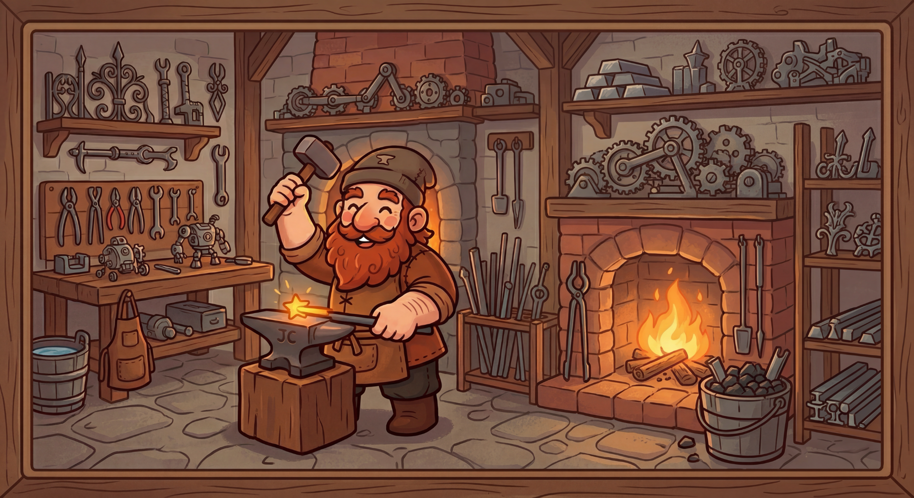

# Joycraft

<p align="center">
  
</p>

Joycraft helps your coding agent do larger work without losing track. You say what
you want. The agent writes it down, splits it into small steps, and builds each step
with tests. Then a second agent checks each step before it counts as done.

## Install: paste this into your coding agent

Open your coding agent in your project (Claude Code, Codex, Pi, Oh My Pi, GitHub
Copilot CLI or OpenCode) and paste:

```text
Install Joycraft in this project.
1. Run `npx joycraft@latest init . --plan --json`. Show me the files it will add in a short table. Do not change anything yet.
2. Ask me which coding agents I use in this project (default: you). Then run
   `npx joycraft@latest init . --harness <agents> --yes`.
   If it finds Joycraft 0.7, stop and show me its migration plan.
3. Use the joycraft-entry skill to set up Joycraft's context map. Read the project's
   docs, interview me about what the repo cannot tell you, then show me the
   AGENTS.md and CLAUDE.md changes on a page before you write them. If the project
   is new or empty, ask me what I want to build.
4. Show me the review loop that setup found: for each package, the tool that
   checks it and what that tool can show. If setup did not do this, run
   `node .joycraft/runtime/review-tools.mjs plan --root .`. Ask me before you
   install anything.
Do not commit, publish, or ask me for API keys.
```

**Upgrading from 0.7?** Nothing changes until you choose. Paste the
[upgrade prompt](docs/prompts.md#upgrade-from-07): your agent shows you the migration
plan and waits for your yes. To stay on 0.7, paste the
[stay on 0.7 prompt](docs/prompts.md#stay-on-07). More:
[Migrating from 0.7](docs/migrating-from-0.7.md).

## How to use it

After the install, talk to your agent as usual. Joycraft takes over when the work is
bigger than one quick change:

1. **You say what you want.** The agent asks a few questions. Then it writes a short
   brief that ends with "Done when": the result you will accept. You approve it.
2. **The agent splits the brief into specs.** A spec is one small step that it can
   build and test alone.
3. **The agent builds each spec with tests.**
4. **A second agent checks each spec.** It did not write the code. It reads the spec,
   runs the checks, and says PASS or FAIL. Only a PASS completes the spec. For a
   screen or page, it looks at the real result with the package's review tool
   (see [The review loop](#the-review-loop)).
5. **The agent wraps up.** It records what it learned for the next session.

You do not need to call the Joycraft skills by name. Describe the work and the agent
picks the right step.

On a new, empty project, the agent first asks what you want to build. It writes your
answers to `docs/context/project.md`. It does not choose a stack or write app code at
this step.

## The context map: your project's memory

`AGENTS.md` holds a short context map. Each line links one project document and
says when to read it. The documents live in `docs/context/`: what the project is,
who it is for, the decisions you made and why. Before each piece of work, the agent
uses the map to find the documents and the code that apply.

**After you install, the agent builds the map with you.** It reads your docs, gives
each one a role, checks what they claim against the code, and asks you what the repo
cannot tell it. Then it shows you the AGENTS.md and CLAUDE.md changes on a page and
writes them only on your yes. In a large project it maps the main docs first and
the rest of the project as work reaches it. If Joycraft is not wired into AGENTS.md
yet, `init`, `update` and `doctor` say so, and the agent sets it up before any other
Joycraft work.

The map grows with the project:

- **New facts go to one home.** When you decide something, the agent records it
  where it belongs and gives a new document a row in the map. It updates an
  existing document; it does not make a copy.
- **The map says what is true now.** A changed fact is rewritten in place. The
  reason goes to the decision log and old versions stay in Git and the archive, so
  a fresh session reads the current state instead of replaying history.
- **Finished work becomes history.** A completed feature moves to `docs/archive/`.
  The agent can check it later to catch a regression.
- **Mistakes become lessons.** When the checking agent fails a spec, the cause can
  become a short note for the next agent.
- **Ideas for later stay visible.** A choice you put off is marked "backlogged". It
  stays out of the current work, but it is not lost.

You can feed it too. Say "add this to the project context", "remove that rule" or
"what does the map say about billing", or give your agent meeting notes, a photo of
a whiteboard or a screenshot. It puts each fact in its home, keeps the map right, and
shows you the change first. This gives the
agent both views: the whole project and the detail of the current step.

### What in `docs/` is current

- **`docs/context/` is current.** It holds what the project is and the decisions you
  made. The agent keeps it up to date.
- **`docs/features/` is working material.** Briefs and specs record the plan for one
  piece of work. They can be out of date while the work runs. The spec queue
  (`.joycraft-spec-queue.json`) is the status of record, not the text.
- **`docs/archive/` is history.** Finished features move there.

**Your wiki.** Joycraft works with the wiki you already keep. Tell your agent where
it is: the agent links it from the context map and can update it each time a
feature is archived. In doc audits, `docs/features/` and `docs/archive/` are
working material and history, not current knowledge. A built-in wiki is under
consideration ([decision D6](docs/context/decision-log.md)).

```text
We keep a wiki in <where>. Link it from the context map, and keep it up to date
each time a feature is archived.
```

### Settings

Joycraft works with no settings. To change one, say what you want:

```text
Keep Joycraft's briefs and specs in working/features.
Whenever a feature is archived, run our wiki sync script.
The page docs/context/auction-rules.md describes src/auction. Flag it when that code changes.
```

The agent writes the change to `joycraft.yaml` at the project root, shows it to you
first, and checks it. Ask "What are my Joycraft settings?" to see what is in effect.
The file is yours: Joycraft changes it only when you ask. If a command run after an
archive fails, the archive still counts as done.

### Keeping the workspace clean

At the end of a session the agent checks the workspace for you. You do not run
anything:

- **Status.** It finds specs whose text disagrees with the queue, and features that
  are finished but not archived.
- **Worktrees.** It removes its worker worktrees once their spec is done and merged.
  It keeps anything unfinished, unmerged or not made by Joycraft, and says why.
- **One coordinator.** One session coordinates each queue, so a second session's
  instructions do not reach the first session's workers.
- **Stale knowledge.** It reports finished features not archived, context pages that
  link to working material, broken, missing or unmapped pages, an AGENTS.md over its
  word budget, and pages whose code changed.
- The doc audit, based on [doc-cleanup](https://github.com/aka-luan/doc-cleanup),
  runs at every session end without being asked. It covers AGENTS.md, CLAUDE.md, the
  docs the session changed and the pages they link; after a feature is archived, the
  whole project. It checks each claim against the code, keeps your rules and traps,
  puts its findings on the session-end page, and changes nothing until you approve.
  Ask your agent to "clean up the docs" for a full audit at any time.
- **Wiring.** It checks that AGENTS.md has the Joycraft lines and a real context map,
  and that CLAUDE.md imports it.

Tests name the acceptance criterion they check, `[AC:<criterion-id>]`, so the
reviewing agent can see which criteria have a test. A criterion with no test is a
finding for the reviewer, not an automatic FAIL.

If your docs are step-by-step procedures, the agent can offer
[Doc Detective](https://docs.doc-detective.com) to run them as tests. It is opt-in:
the agent says what it does not cover and installs nothing without your yes.

## The review loop

The reviewing agent needs a tool that shows the real result: a browser for a web
app, a simulator for a mobile app, an HTTP check for an API. Joycraft decides what
counts as evidence; your project keeps its own tools.

- **Setup finds your tools.** For each package it looks for the tool you already
  use (Playwright, Cypress, WebdriverIO, Maestro, Newman, an e2e script, a CI job
  and others) and records one row per package in AGENTS.md, with what that tool can
  show. Tools that belong to this machine, such as your agent's built-in browser, go
  to `.joycraft/local/`. Packages that are not declared workspaces are found too, or
  name them with `--packages`.
- **A gap gets one recommendation.** If a package has no tool, the agent recommends
  one with its trade-offs and offers to look at others. It installs only on your yes,
  and never with `sudo`, a licence or a sign-in. A project with no app records that
  once and is not asked again.
- **Limits you agreed to are not failures.** A claim the recorded tool cannot show,
  or a package you skipped, is reported as a limit. `UNVERIFIED` means a check that
  should have run and did not.
- **Skipping review for one feature.** Say "skip review" in the feature interview.
  The feature's `waiver.json` records your words, and no reviewer runs for it. A
  waiver never hides a FAIL, and a new install keeps every check on.
- **A broken tool holds one spec.** If the browser or server breaks, the agent
  tries one repair (restart, free the port, relaunch). Then it holds that spec as
  `UNVERIFIED`, tells you, and keeps the rest of the queue going.

After an update, the agent checks the review loop again and asks only about what
changed.

## Answering questions: the decision page

When the agent needs you to choose between options, it asks in your question
style. Setup asks for it once: one decision at a time with a short talk about each
answer, or a page of decisions; on a decision page or as numbered prose in chat.
To change it for one feature, say:

```text
Ask me one question at a time, in chat, for this feature.
```

A consequential question gives the context, the question, two to four options each
with an example and a trade-off, and the agent's recommendation with its reason. On
the decision page, you pick an answer, or "Something else" and say what you want,
add a note if you want, and save. You can add or change a note after saving. If the
brief changes while the page is open, the page names the questions that changed and
keeps your other answers. In chat or on the page, the answers go into the brief, so
the agent does not ask again. If a question is not clear, say "wait, what?" and the
agent explains it again with more context.

**Colors.** The page uses a light or dark theme. To match your project, ask:

```text
Use our design system's colors for Joycraft artifacts.
```

The agent reads your project's color tokens and saves them in
`.joycraft/preferences.json`. You can also give it your own colors. Joycraft
refuses colors that make text or buttons hard to read.

## What Joycraft is

Joycraft is a set of agent skills and a small set of scripts. It installs into your
project:

- Skills in `.claude/skills/` (Claude Code) or `.agents/skills/` (all other agents)
- Scripts and templates in `.joycraft/`
- Project notes in `AGENTS.md`, `CLAUDE.md` and `docs/`. These are yours: Joycraft
  adds to them and never removes them.

All of it lives in your repository. Joycraft collects no data and does not call an AI
model itself. Its only network use is the version check below. Joycraft adds no
agent hooks and changes no agent settings. A command after an archive runs only if
you asked for one.

## Updates

At the start of a session, your agent checks npm for a newer Joycraft, at most once a
day. The check sends no project data. If there is a new version, the agent tells you
whether it is a patch, a minor release or a migration, lists each release since
yours, and asks: update now, not now, or turn off. Automatic updates apply only
patches. On a yes, it does the update
for you, checks the result, and tells you what is different. After a minor release
it names what you can now do, and asks how you want questions if you have not said
yet. A new major version is
always your choice.

This is an instruction the agent follows, so it can forget. To check yourself, ask:

```text
Check for a Joycraft update.
```

## Hosts

| Host | Skills | Tested |
|---|---|---|
| Claude Code | `.claude/skills/` | Yes |
| Codex | `.agents/skills/` | Yes |
| Pi | `.agents/skills/` | Yes |
| Oh My Pi | `.agents/skills/` | Yes |
| GitHub Copilot CLI | `.agents/skills/` | Installs; full run not tested yet |
| OpenCode | `.agents/skills/` | Installs; full run not tested yet |

"Tested" means: we installed Joycraft in a test project, one agent built a spec, and
a second, separate agent checked it and passed it.

## Everything else: ask your agent

You never need to run a Joycraft command yourself. Each of these is a short prompt
in [Prompts](docs/prompts.md):

| You want to | Say |
|---|---|
| Update Joycraft | "Check for a Joycraft update." |
| Check the install | "Check my Joycraft install." |
| Change a setting | "Keep Joycraft's specs in working/features." |
| Connect your wiki | "Link our wiki and keep it up to date." |
| Clean up | "Clean up the docs and the workspace." |
| Undo the 1.0 upgrade | "Undo this project's upgrade to Joycraft 1.0." |
| Remove Joycraft | "Remove Joycraft from this project." |

The CLI commands behind them are in the [install guide](docs/install.md#cli-reference).

More: [Install guide](docs/install.md) · [Migrating from 0.7](docs/migrating-from-0.7.md) ·
[Prompts](docs/prompts.md) · [Changelog](CHANGELOG.md) · [Security](SECURITY.md) ·
[Contributing](CONTRIBUTING.md) · [License](LICENSE)

## Acknowledgments

These people shaped how Joycraft decides what an agent should keep and what it
should forget:

- **Mario Zechner** (creator of [Pi](https://github.com/earendil-works/pi-coding-agent)) and **Armin Ronacher** (creator of Flask): "code is truth". Do not keep a separate memory of what the code already says.
- **Theo Browne** ([t3.gg](https://t3.gg)): measure which notes an agent actually reads, and keep `AGENTS.md` short and directional.
- **Lauren** (Cursor): prefer fixes in this order: architecture, then lint and CI, then skills and rules, then asking a human.
- **Robert C. Martin**: impose values, not disciplines.
- **aka-luan** ([doc-cleanup](https://github.com/aka-luan/doc-cleanup), MIT), brought to Joycraft by **David Moshal**: Joycraft's doc audit follows its method. Treat every doc claim as a hypothesis and the code as the evidence.
- **David Moshal**, with his `questions-dm` skill: ask one question at a time, give the context first, and never assume the user remembers what the agent remembers. **Matt Pocock** ([`wait-what`](https://github.com/mattpocock/skills/tree/main/skills/productivity/wait-what), MIT): when a message does not land, say it again in plain words with the missing context.

The levels this project aims at are Dan Shapiro's. See [The levels](docs/guides/levels.md).

## License

MIT. See [LICENSE](LICENSE).
