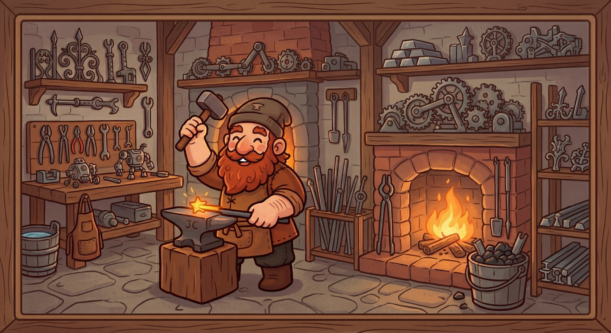

# Joycraft

<p align="center">
  
</p>

> The craft of AI development. With joy, not darkness.

## Install: paste this into your coding agent

Open your coding agent (Claude Code, Codex, Pi, Oh My Pi, GitHub Copilot CLI or
OpenCode) in your project and paste:

```text
Install Joycraft in this project.
1. Run `npx joycraft@latest init . --plan --json` and show me the plan in a short table. Change nothing yet.
2. Ask me which hosts to install for (default: the one you are), then run
   `npx joycraft@latest init . --harness <hosts> --yes`.
   If it reports a Joycraft 0.7 install instead, stop and show me its migration plan.
3. Use the joycraft-entry skill to set up this project. If the project is new or empty,
   offer me the kickoff so I can tell you what I want to build.
4. Run the review-loop plan from the setup step. Show me which verification tools are
   present or missing, and ask before installing anything.
Do not commit, publish, or ask me for API keys.
```

**Upgrading from 0.7?** Nothing changes until you choose. `npx joycraft@latest update .`
on a 0.7 project prints the migration plan and stops. Read
[Migrating from 0.7](docs/migrating-from-0.7.md), or paste the
[upgrade prompt](docs/prompts.md#upgrade-from-07). To stay on 0.7:
`npx joycraft@0.7.17 update`.

## What Joycraft is

Joycraft is a skill bundle and a small runtime for agent-led software work. It
installs into your project and gives your agent one loop:

1. **Entry** (`joycraft-entry`): sets up the project's guidance on first use, offers a
   kickoff on a new project, and turns a request into a brief with a settled "Done when".
2. **Context** (`joycraft-context`): finds the project files that matter for the request.
3. **Decompose** (`joycraft-decompose`): splits the brief into small specs in a queue.
4. **Implement** (`joycraft-implement`, `joycraft-testing`): builds each spec with tests.
5. **Independent review** (`joycraft-verify`): a separate agent context reviews the work
   against the spec; only its PASS completes the spec.
6. **Session end** (`joycraft-session-end`, `joycraft-retro`): wraps up and keeps what
   was learned.

A UI spec gets a rendered check (`joycraft-ui-slice`) with the tools recorded in the
`Review loop` section of `AGENTS.md`.

Everything Joycraft writes is in your repository: skills, the runtime in `.joycraft/`,
and your project's knowledge in `AGENTS.md`, `CLAUDE.md` and `docs/`. It collects no
data and calls no model of its own.

## Hosts

| Host | Skills | Live evidence |
|---|---|---|
| Claude Code | `.claude/skills/` | Passed: implement, then a separate reviewer completes the spec |
| Codex | `.agents/skills/` | Passed |
| Pi | `.agents/skills/` | Passed |
| Oh My Pi | `.agents/skills/` | Passed |
| GitHub Copilot CLI | `.agents/skills/` | Installs; live run not yet recorded |
| OpenCode | `.agents/skills/` | Installs; live run not yet recorded |

The live runs install Joycraft into a test project, implement one spec in one host
process and review it in a second one. Joycraft 1.0 installs no hooks.

## Commands

For people who want them (your agent runs these for you):

```bash
npx joycraft@latest init . --harness claude,codex --yes    # install
npx joycraft@latest update . --yes                         # update; edited Joycraft files are backed up first
npx joycraft@latest doctor .                               # check the install
npx joycraft@latest update . --migrate --archive-custom --yes   # migrate a 0.7 project
npx joycraft@latest rollback --yes                         # undo the migration
```

`--plan --json` shows any change without making it. Without a terminal or `--yes`,
the CLI prints its plan and exits 1; it never waits on a prompt.

More: [Install guide](docs/install.md) · [Migrating from 0.7](docs/migrating-from-0.7.md) ·
[Prompts](docs/prompts.md) · [Changelog](CHANGELOG.md) · [Security](SECURITY.md) ·
[Contributing](CONTRIBUTING.md) · [License](LICENSE)

## Acknowledgments

Joycraft's curated-harness stance was shaped by people thinking out loud about what agents should and shouldn't remember:

- **Mario Zechner** (creator of [Pi](https://github.com/earendil-works/pi-coding-agent)) and **Armin Ronacher** (creator of Flask) — "code is truth" and the minimal-harness thesis: no separate memory system for knowledge the code already carries.
- **Theo Browne** ([t3.gg](https://t3.gg)) — the write-vs-read memory audit that turned decay into something measurable, and the case for directional rather than rule-heavy AGENTS.md content.
- **Lauren** (Cursor) — the intervention-elimination hierarchy: architecture beats lint and CI, which beat skills and rules, which beat asking a human.
- **Robert C. Martin** — impose values, not disciplines.

The levels this project aims at are Dan Shapiro's; those credits live in [The levels](docs/guides/levels.md).

## License

MIT. See [LICENSE](LICENSE) for details.
