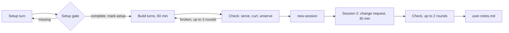

# The ride trial: Joycraft's framework benchmark

Updated: 2026-11-22.

The ride trial is a head-to-head build test. Several builders, each set up with
a different framework, build the same small app from the same user messages.
Blind judges score the apps. An analyst reads the transcripts. Run it before
every big Joycraft release, to see where Joycraft wins and where it loses.

The first task is a tongue-in-cheek Next.js app: "Can I ride through Mill
Valley?" It checks the tides and the weather and says if the bike path is under
water. v1 (2026-11-22) and v2 (2026-11-23) used it.

This guide tells you how to rebuild and run the trial from nothing. The plan for
how the trial fits normal Joycraft development is in
[`docs/features/2026-11-22-benchmark-trial/recommendation.md`](../features/2026-11-22-benchmark-trial/recommendation.md).

## Where the harness lives

The harness is not in this repo yet. The maintainer keeps it in
`~/Developer/ride-trial/`:

| Path | Contents |
|---|---|
| `trial/`, `trace/`, `arms/`, `judge/` | v1: one run per arm, one session |
| `v2/trial/` | v2 driver (`turn.mjs`), collector (`collect.mjs`), `config.json`, message templates |
| `v2/arms/<arm>-r<N>/` | the builder's project folder for one arm-run |
| `v2/trace/<arm>-r<N>/` | that run's state, events, turn traces, rendered messages, user notes |

The recommendation proposes to move the scripts and templates to `bench/` in
this repo (decision `harness-home`). Until the maintainer agrees, copy them from
the harness folder.

## Design

### Terms

- **Arm.** One framework set-up, for example `joycraft`, `pocock`, `pstack` or
  `vanilla`.
- **Arm-run.** One arm in one round, for example `joycraft-r2`. Each arm-run has
  its own empty folder, port and trace.
- **Builder.** A real Claude Code session (`claude -p`) that does the work.
- **User agent.** An agent that plays the user, "Max". It talks to its builder
  only through the driver.
- **Operator.** The person or session that runs the trial.

### Arms

| Arm | Framework | Setup message names |
|---|---|---|
| `joycraft` | Joycraft | `Joycraft (https://github.com/maksutovic/joycraft)` |
| `pocock` | Matt Pocock's skills | `Matt Pocock's skills (https://github.com/mattpocock/skills)` |
| `pstack` | pstack | `pstack (https://github.com/backnotprop/pstack)` |
| `vanilla` (proposed) | none | no framework; same entry files, docs and context map request |

Every builder uses the same model and effort (v1 and v2: `claude-opus-5-5`,
`medium`), set in `config.json`. `TRIAL_MODEL` in the environment overrides the
model for a smoke run.

### Flow of one arm-run



1. **Setup.** The user agent sends `01-setup.md`. The builder installs the
   framework at the project level and writes `AGENTS.md`, `CLAUDE.md`, a `docs/`
   folder and a context map. No app code.
2. **Setup gate.** The user agent checks that the entry files, `docs/` and a
   context map exist. If one is missing, it asks again. When all exist, it runs
   `mark-setup`. That records the file tree and starts the build clock.
3. **Build.** The user agent sends `02-build.md`, the maintainer's raw prompt
   with its typos. It answers questions from the answer sheet and keeps the
   builder moving.
4. **Check.** When the builder says it is done, the user agent runs `serve`,
   curls the page and the API routes, and runs `unserve`. It sends up to three
   fix rounds.
5. **Session 2.** The user agent runs `new-session`. The next `send` starts a
   fresh builder with a new session id and no memory of session 1. It sends
   `03-session2.md`, a change request (v2: "add a 3 day forecast"). It does not
   explain the project. The new builder must find its way from the repo.
6. **Notes.** The user agent writes `user-notes.md`: messages, questions and
   answers, friction, setup output, check results, what session 2 read first,
   and a 1–10 "pleasant to work with" score for each session.

### Time limits

Set in `config.json`:

| Key | v2 value | Use |
|---|---|---|
| `buildLimitMinutes` | 60 | Session-1 limit, counted from `mark-setup`. The user agent asks for a wrap-up at 55 min. |
| `session2LimitMinutes` | 30 | Session-2 limit. Wrap-up at 27 min. |
| `hardCapMinutes` | 180 | The driver refuses to send, and kills a running turn, after this. |
| `waitSeconds` | 540 | One `wait` call blocks at most this long. Keep it below the user agent's 10-minute Bash timeout. |
| `quietSeconds` | 90 | A turn ends when the last trace line is a result and the trace has been quiet this long. |

The driver prints the clock after each reply. The limits are told to the
builder in the messages ("you have a 1 hour time limit"). No limit bit in v1 or
v2: every builder finished early.

### Ports

Each arm-run has its own port in `config.json` `ports`: `31<round><arm>`
(`joycraft-r1` 3111, `pocock-r1` 3112, `pstack-r1` 3113, then 3121–3123,
3131–3133). `smoke` is 3199. Give a new arm the next digit (`vanilla-r1` 3114).
The operator note tells each builder its port. Do not run anything else on
3101–3199 while a trial runs.

### Driver commands

The user agent runs these from the harness `trial/` folder:

| Command | What it does |
|---|---|
| `node turn.mjs send <arm> <file>` | Starts one builder turn in the background and returns at once. Refuses while a turn runs. |
| `node turn.mjs wait <arm>` | Blocks up to `waitSeconds`. Prints `=== BUILDER REPLY` when the turn ends, or "Still working": then call it again. |
| `node turn.mjs mark-setup <arm>` | Records setup done (once). |
| `node turn.mjs new-session <arm>` | Ends session 1. The next `send` starts session 2. |
| `node turn.mjs serve <arm>` / `unserve <arm>` | Starts or stops the app on the arm's port. Uses `npm run dev -- -p <port>`, or `npx next dev` when there is no `dev` script. Waits up to 2 min for HTTP. |
| `node turn.mjs status <arm>` | Prints the state. |

Each `send` runs:

```bash
claude -p "<message>" --output-format stream-json --verbose \
  --model <model> --effort <effort> --permission-mode bypassPermissions \
  --setting-sources project,local --strict-mcp-config \
  --disallowedTools AskUserQuestion \
  --session-id <uuid>   # first turn of a session; later turns use --resume <uuid>
```

The process is detached in its own process group. Its stdout goes to
`trace/<arm>/turn-<N>.jsonl` and stderr to `turn-<N>.stderr.log`.

## Isolation

The builders run on a machine with the operator's own Claude Code set-up. Keep
that set-up out of the builders:

- **`--setting-sources project,local`.** The operator's user settings, hooks and
  plugins do not load. The v2 init lines confirm it: the operator's user skills
  are not in the builder's `skills` list.
- **`--strict-mcp-config`.** No MCP servers load (`"mcp_servers":[]` in the init
  line).
- **A minimal environment.** The child gets only `PATH`, `HOME`, `USER`,
  `LOGNAME`, `SHELL`, `LANG`, `LC_ALL`, `TMPDIR`, `TERM`, `NVM_DIR` and
  `NVM_BIN`. No parent-session variables, such as `CLAUDE_CODE_*`, leak in.
- **`AskUserQuestion` is disallowed.** A `-p` session cannot show the question
  dialog. Without this, a builder can stall on a question nobody sees.
- **Global-folder snapshot.** Before each turn the driver hashes the names and
  times of `~/.claude/skills`, `~/.agents/skills`, `~/.claude/agents` and
  `~/.claude/commands`. If the hash changes, the reply ends with a WARNING and
  the user agent tells the builder to undo it and install at the project level.
- **Audit the init line.** The first line of each `turn-1.jsonl` is the init
  event. Check `skills`, `plugins`, `mcp_servers` and `memory_paths` before you
  trust a run.

## Driver traps found and fixed

| Trap | Effect | Fix (v2) |
|---|---|---|
| A `claude -p` process stays alive after its result line, while background tasks run | v1 `wait` waited for the process to exit. Build turns showed 18–21 min of wall clock for 11–12 min of work. | `wait` ends a turn when the last line is a result and the trace is quiet for `quietSeconds`. `finish` then kills the process group (SIGTERM, then SIGKILL). Use `duration_ms`, not wall clock. |
| A resume while the old process lives returns an empty result with `num_turns: 0` | v1: three empty replies (pstack turn 3, joycraft turns 3 and 5). The user agents had to resend. | `send` refuses while a turn runs, and `finish` kills the old process first. Result lines with `num_turns: 0` are ignored. |
| One turn has several results (a background reviewer ends the turn, then the builder resumes) | v1 kept only the last result. The user saw a dev-server note, not the summary. | `finish` joins every real result of the turn into the reply. |
| A builder ran `pkill -f "next-server"` | v1: it killed the other two arms' dev servers within seconds. Both users docked points for a "flaky" server. Two arms also shared `/tmp/mv-dev.log`. | The operator note (below) forbids kill-by-pattern and temp files outside the project. Each arm has its own port. The user agent starts the app itself with `serve`. |
| Builders write Claude Code auto-memory to `~/.claude/projects/<arm-folder>/memory/` | The memory is keyed on the arm folder, and session 2 uses the same folder. Session 2 can load session 1's notes (v1: 2 of 3 arms; v2 rounds 1–2: 4 of 6 arm-runs saved `commit-as-you-go.md`). That spoils the fresh-session test. | **Not fixed in v2.** Fix before the next trial: turn auto-memory off for builders (check the current setting name in the Claude Code docs, and prove it in the smoke run), and make `new-session` refuse while that memory folder holds files. Do not use `--bare`: it also skips hooks and `CLAUDE.md` discovery, which the frameworks need. |

## The user agent

Run one user agent for each arm-run, as an Opus agent (a subagent of the
operator's session). Give it its rendered `persona.md` as the whole prompt.
Run the arm-runs of one round at the same time.

### Persona

`persona.template.md` has three placeholders: `{{FRAMEWORK}}`, `{{ARM}}` and
`{{PORT}}`. The persona:

- plays "Max", a product owner, and never edits project files;
- uses only the driver, with a 600000 ms Bash timeout and `wait` in the
  foreground;
- may read the arm's folder and curl the app, never another arm's folder;
- follows the session-1 and session-2 steps above, with the wrap-up times;
- never mentions other frameworks, other arms or a comparison;
- gives no implementation instructions beyond the prepared messages and the
  answer sheet;
- returns six lines: finished per session, minutes, messages, check results,
  scores.

### Answer sheet

Every user agent gives the same answers:

| Question | Answer |
|---|---|
| Styling, components, Tailwind | "your call, keep it simple" |
| App Router, TypeScript | "yep, fine" |
| Tests | "a few useful ones, don't overdo it" |
| Deploy | "no, local only" |
| API keys | "i don't have any, use free keyless APIs" |
| Tide station, threshold | "your call, just cite where it comes from in the app" |
| Units | "feet and °F" |
| Location denied | "fall back to the ferry building" |
| Git | "yes, commit as you go" |
| Image generation | "no, draw them yourself" |
| Anything else | One short sentence with a sensible default, logged in the notes |

A new task needs its own answer sheet. Write it before the first run.

### Operator note

Every message after setup ends with `operator-note.md`, with `{{PORT}}` filled
in. It says, as machine rules and not as part of the request:

- other projects run on this machine at the same time;
- never kill processes by name or pattern; stop only processes you started, by
  PID;
- keep temp files and logs inside the project folder;
- this app's port is `<port>`;
- do not leave a dev server or other background process running at the end of a
  turn; the user runs the app to check it.

### Messages

For each arm-run, render these into `trace/<arm>-r<N>/msgs/`:

| File | Source |
|---|---|
| `01-setup.md` | `setup.template.md` with `{{FRAMEWORK}}` and `{{URL}}` |
| `02-build.md` | `build.template.md` + operator note |
| `03-session2.md` | `session2.template.md` + operator note |
| `operator-note.md` | `operator-note.md` with `{{PORT}}` |

v2 rendered these by hand. A `prepare.mjs` that renders them from `config.json`
is the first script to add when the harness moves.

## Run it from scratch

1. Copy `turn.mjs`, `collect.mjs`, `config.json` and the templates into
   `<harness>/trial/`. Add a port for each new arm-run.
2. For each arm-run: create an empty `arms/<arm>-r<N>/`, render the messages and
   the persona into `trace/<arm>-r<N>/`.
3. Run a **smoke** arm first, with a cheap model (`TRIAL_MODEL`). Check the init
   line (isolation), one setup turn, `serve` and `unserve`, and `new-session`.
4. Start one user agent per arm-run of round 1, all at the same time.
5. When all return, run the next round. Rounds run one after another so that a
   machine-load spike hits all arms of a round alike.
6. Run `node collect.mjs`.
7. Make the judge copies and run the judges.

## Collection

`collect.mjs` reads every `trace/<arm>-r<N>/` and writes `trace/metrics.json`
with one row per arm-run and a mean ± standard deviation per arm.

- **Cost.** `total_cost_usd` on a result line is cumulative for the session.
  Take the maximum for each session and add session 1 and session 2. Do not add
  the per-turn values.
- **Tokens.** `modelUsage` on a result line is also cumulative, per model.
  Input = `inputTokens + cacheReadInputTokens + cacheCreationInputTokens`.
  Output = `outputTokens`.
- **Active time.** The sum of `duration_ms` over the real results (`num_turns >
  0`). Split it into setup (turns that ended before `mark-setup`), build, and
  session 2. Never use wall clock: it includes driver waits and lingering
  processes.
- **Steps.** The sum of `num_turns`.
- **Output.** Words in `AGENTS.md` and `CLAUDE.md`, words of Markdown in `docs/`
  (framework folders excluded), test cases (`it(` and `test(`), test files,
  commits, and whether a global folder changed.
- **Transcripts.** It copies `~/.claude/projects/<arm-folder>/` into
  `trace/<arm>-r<N>/transcripts/`, for subagent transcripts.

The collector does not count what the user agent and the judges cost. Record
those from the operator's session usage.

## Judging

### Blind copies

For each arm-run, copy the app into `judge/<label>/` with shuffled labels (`A`,
`B`, `C`, …). Keep the key in `trace/judge-key.txt`, which no judge reads.

The copy holds the app source, tests, package files and two screenshots: the live
state and the app's own flooded demo, taken by the operator with headless Chrome
at the same time for all arms. Leave out `.claude/`, `.agents/`, `.joycraft/`,
`.pstack/`, `docs/`, `AGENTS.md`, `CLAUDE.md`, `.git/`, `node_modules/` and every
log. v1 left a `dev-server.log` in one copy; remove logs. Code can still name its
framework (for example `[AC:...]` tags in test names): say so in the caveats.

### Roles

| Role | Blind | Reads | Output |
|---|---|---|---|
| Product judge | yes | judge copies, screenshots, the build message | `/50`: brief coverage, fun and tone, illustrations, clarity, recommendation logic (10 each) |
| Engineering judge | yes | judge copies | `/40`: correctness, robustness, code quality, tests (10 each) |
| Process analyst | no | transcripts, `metrics.json`, user notes, operator notes, arm folders | what each framework did, used, skipped and cost, with trace citations |
| Chair | unblinds | all of the above and the key | headline, scoreboard, what each framework added, ranked lessons for Joycraft, caveats |

Judges read and never run, install or start anything. Each judgment cites file
and line. v1's outputs are good models.

### Caveats to state every time

- **n.** v1 had one run per arm. A 1–4 point gap is noise at n = 1. Report mean ±
  standard deviation and call a gap smaller than one standard deviation a tie.
- **Builder variance.** In v1 the biggest score swings came from two choices no
  framework prompted.
- **Same model.** The result says nothing about a weaker model.
- **Task size.** A small app never hits the time limit.
- **Install fidelity.** Note which arms ran a real installer and which were
  vendored or set up by hand.
- **Blindness.** The judges are blind; the analyst is not.
- **Live data.** Tides and weather change between screenshots of different
  rounds. Take one round's screenshots at the same time.

## Cost

| Run | Builder cost per arm-run (exact) | Active minutes |
|---|---|---|
| v1 | $2.55–4.58 | 9.7–13.8 (one session) |
| v2 round 1 | $3.30–9.02 | 8.0–20.3 (both sessions) |

Plan for $5–10 of builder cost per arm-run, plus the user agents and the judges.
Four arms × three rounds is about $100–150 in all.
