# The Interview: Why It Matters

> [Back to README](../../README.md)

The biggest change Joycraft makes to your work is this: before the agent writes
code, it asks you questions and writes down what you want.

Without that step, you type "build me a notification system" and the agent starts
at once. It guesses your data model, your UI framework, your error handling and
your deployment target. You catch some guesses and correct them, and the agent
makes new ones. Three hours later the work *kind of* works, on a base of guesses.

Joycraft changes the order. First you and the agent agree on *what you are
building and why*. Then the agent builds it.

## How it works

You do not call a skill by name. Describe the work and the agent picks the step.

1. **You say what you want.** The `joycraft-entry` skill reads the project's context
   map, then asks you only what the code and the docs cannot tell it.
2. **The agent writes a brief.** The brief is in `docs/features/<slug>/brief.md`. It
   says what you want, why, and ends with "Done when": the result you will accept.
   Each open choice is a decision in the brief, and the agent asks it on a page.
   You approve the brief.
3. **The agent splits the brief into specs.** `joycraft-decompose` writes small specs
   and a queue (`docs/features/<slug>/specs/.joycraft-spec-queue.json`). Each spec is
   one step that an agent can build and test alone.
4. **The agent builds each spec.** `joycraft-implement` builds the queue with tests.
5. **A second agent checks each spec.** `joycraft-verify` runs in a separate context.
   Only its PASS completes a spec.
6. **The agent wraps up.** `joycraft-session-end` reports the real state of each spec,
   records what the work taught, and archives a feature when all of it is accepted.

For a choice about a screen or a page, `joycraft-ui-slice` builds a small working
preview, so you can choose from the real thing.

A prompt to start:

```text
I want to add <what you want>. Ask me what you need to know first, then show me
the brief on a page before you write any specs.
Do not commit, publish, or ask me for API keys.
```

## Why this works

The idea comes from [Boris Cherny](https://www.lennysnewsletter.com/p/head-of-claude-code-what-happens)
(Head of Claude Code at Anthropic): interview in one session, write the spec, then
build in a *fresh session* with clean context. The interview captures your intent.
The spec is the contract. The building agent has only the spec, with no leftover
misunderstandings and no context window full of abandoned approaches.

This is the step from Level 2 (back-and-forth prompting) to Level 4 (spec-driven
development). See [The levels](levels.md). You stop correcting an agent's guesses
and start saying what must be built.

```mermaid
flowchart LR
    A["You say what you want"] --> B["joycraft-entry<br/>(questions + brief)"]
    B --> C["Brief<br/>docs/features/&lt;slug&gt;/"]
    C --> D["joycraft-decompose"]
    D --> E["Specs + queue"]
    E --> F["joycraft-implement<br/>(tests while it builds)"]
    F --> G["joycraft-verify<br/>(separate reviewer)"]
    G --> H["joycraft-session-end<br/>(report + archive)"]

    style B fill:#e8f4fd,stroke:#369
    style E fill:#cfc,stroke:#393
    style G fill:#ffd,stroke:#993
```


